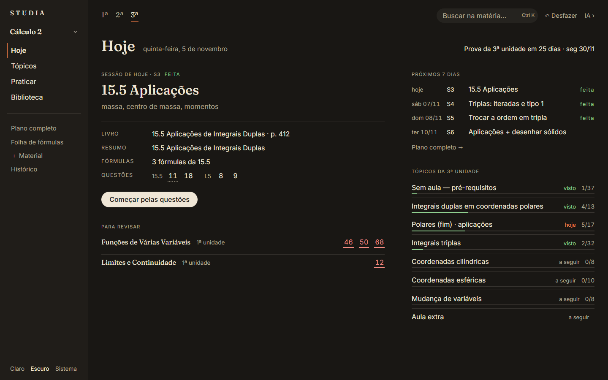
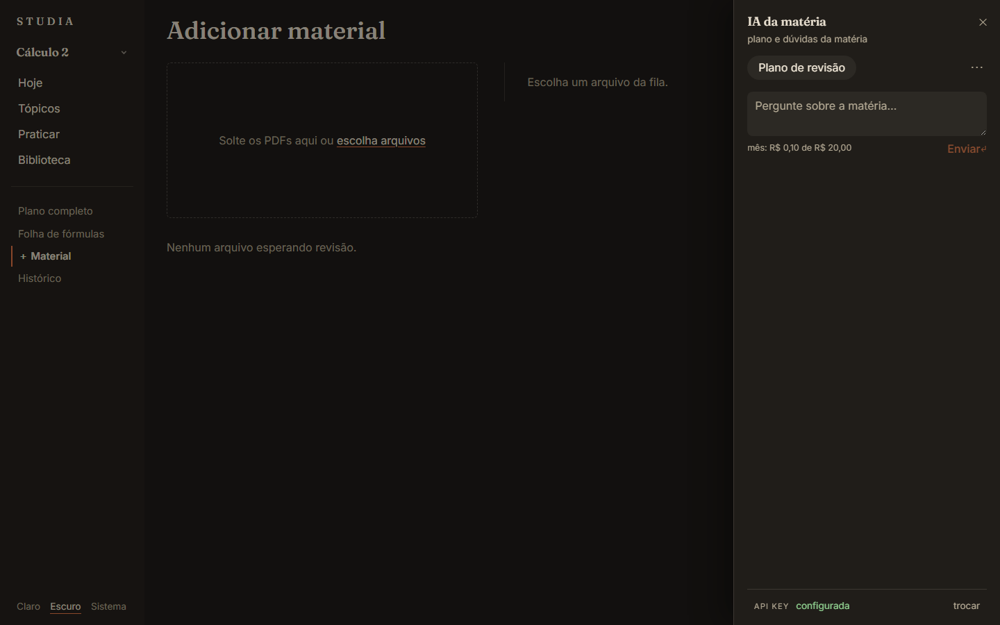
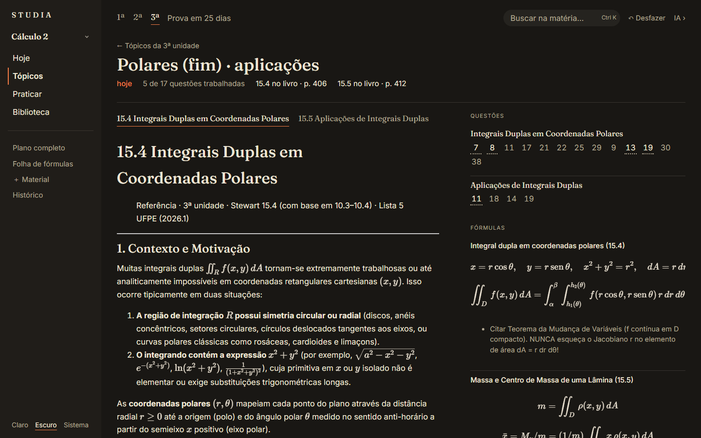
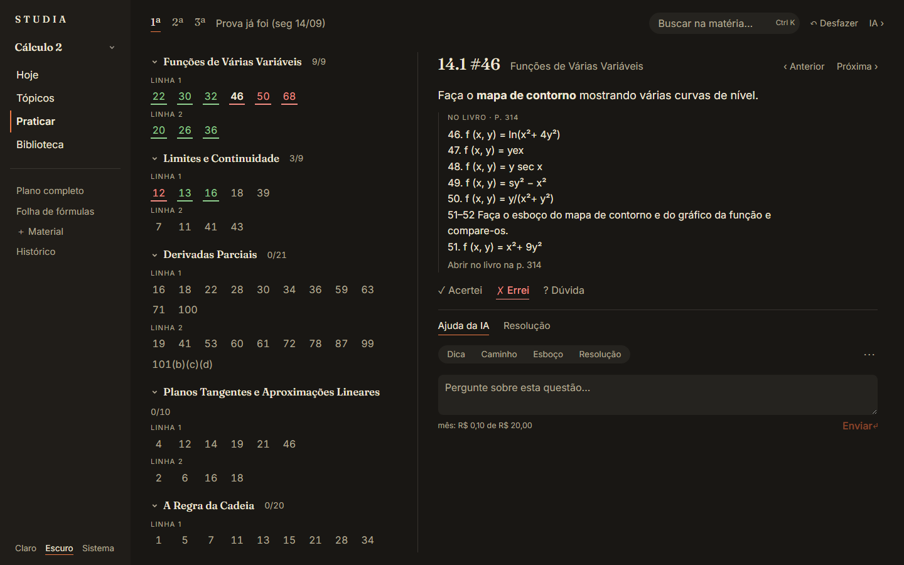
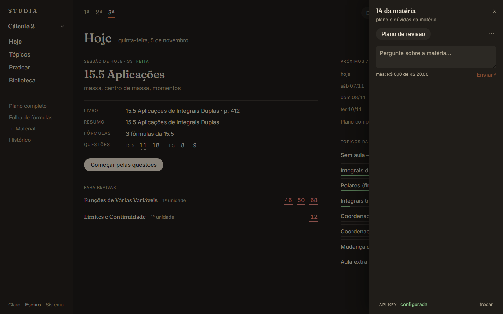
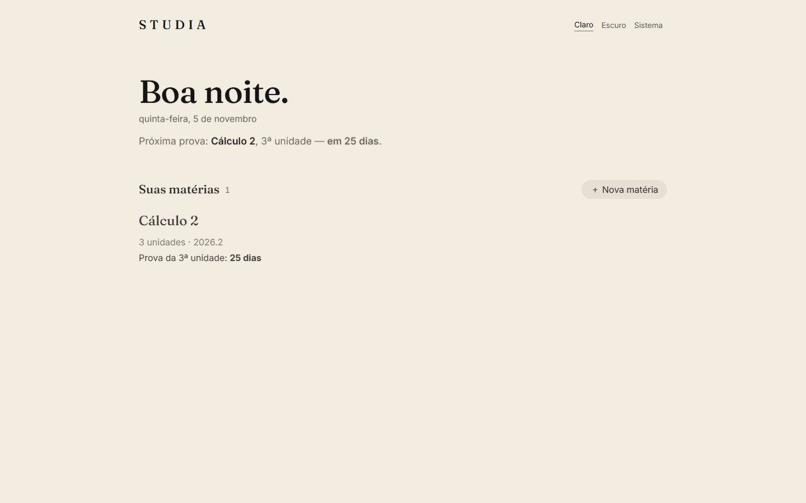
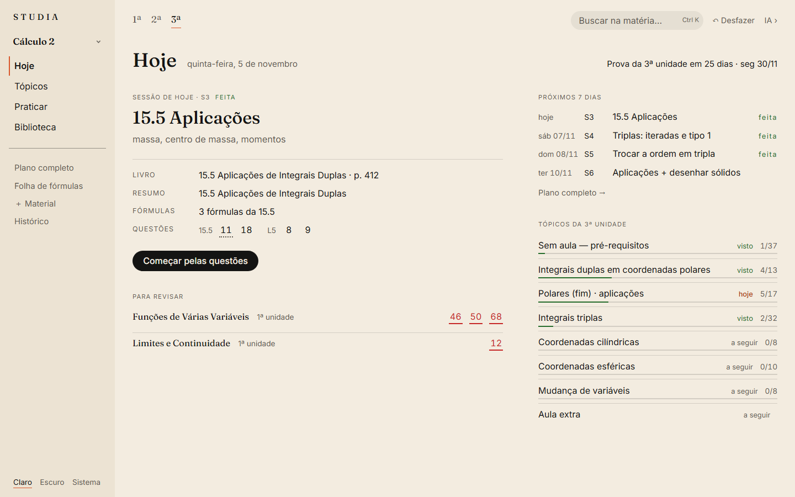

<div align="center">

# STUDIA

**Uma plataforma de estudos para a faculdade, construída inteira conversando com uma IA.**

Você solta os PDFs da matéria. Ela monta as unidades, os tópicos e as listas, abre cada dia na sessão de estudo
certa, com o material a um clique, e tem uma IA que ajuda nas questões citando o livro.


[Guia de uso](docs/guia.md) · [A ideia do projeto](docs/ideia.md) · [Tecnologia e evolução](docs/tecnologia.md)

<br>



</div>

## Por que existe

Estudar uma disciplina de exatas é juntar coisa espalhada: o programa e o calendário da turma, um ou dois livros,
listas de exercícios, slides, anotações. Saber o que cai na prova, o que já foi feito e o que precisa ser revisado
vira um trabalho em si.

O STUDIA junta tudo por matéria e por unidade, roda **no seu computador** e guarda tudo **em arquivos na pasta do
projeto**. E é também um experimento: **nenhuma linha foi escrita à mão**. Cada tela, teste e decisão saiu de conversas
com o Claude, com o autor aprovando cada passo. A história completa está em [A ideia do projeto](docs/ideia.md).

## O que ele faz

### Organiza a matéria sozinho, por regras

Solte os PDFs (programa, calendário, livros, listas) e o app propõe as unidades, as datas das provas, os tópicos, as
questões e as seções do livro. Cada item vem com uma nota de confiança, e o que ele não tem certeza aparece para você
conferir antes de gravar. Nada disso depende de IA.



### Abre o dia na sessão certa

A tela **Hoje** mostra a sessão do plano de estudo: a seção no livro, o resumo, as fórmulas e as questões daquela
sessão, cada um a um clique. Embaixo, o que você errou em todas as unidades; ao lado, os próximos 7 dias e cada
tópico com o progresso, que se calcula sozinho pelas datas do plano, pelas marcações e pelas resoluções (nada de
marcar à mão). Com 7 dias ou menos até a prova, entra a **reta final**.

Cada tópico tem uma página própria: o resumo para ler no centro e, ao lado, as questões, as fórmulas e as resoluções.



### Ajuda nas questões, do jeito que você pedir

Em **Praticar**, a questão aberta mostra o enunciado e, logo abaixo, o original do livro. A ajuda vem em níveis:
**Dica**, **Caminho**, **Esboço** e **Resolução** completa (que pergunta antes e fica gravada). O assistente já recebe o exercício original do livro, a teoria da seção e o seu resumo, e cita de onde tirou
cada coisa. Ele também escreve resumos de seção e monta um plano de revisão até a prova, com o custo de cada resposta
à vista e um teto mensal.

| | |
|---|---|
|  |  |
| Praticar: a questão e a ajuda em abas | A IA da matéria, numa gaveta por cima de qualquer tela |

> As respostas nas fotos vêm do **modo de demonstração**, que roda sem chamar o Gemini.

### E o resto do dia a dia

- o **plano** de aulas e sessões de estudo, a **Biblioteca** de resumos e PDFs, e a **folha de fórmulas** para imprimir;
- **busca** na matéria inteira com Ctrl K, abrindo o PDF na página certa;
- **desfazer** qualquer alteração (Ctrl Z) e um **histórico** de tudo o que mudou;
- tema **claro e escuro**.

| | |
|---|---|
|  |  |
| Tela inicial, tema claro | Hoje, tema claro |

## Começar

Precisa de **Python 3.13** e **Node.js**, no Windows.

1. Dê dois cliques em **`abrir.bat`**, na raiz. Na primeira vez ele prepara o ambiente, o que leva alguns minutos.
2. O app abre em **http://127.0.0.1:8790**. Crie uma matéria e solte os PDFs em **＋ Material**.
3. Para usar a IA, crie uma chave grátis no Google AI Studio e cole em **IA › → API key**.

O passo a passo de cada tela está no **[Guia de uso](docs/guia.md)**.

## Documentação

| Página | O que tem |
|---|---|
| **[Guia de uso](docs/guia.md)** | abrir, criar uma matéria, cada tela, busca, desfazer e o assistente |
| **[A ideia do projeto](docs/ideia.md)** | o experimento de construir tudo com IA, os princípios e o método de trabalho |
| **[Tecnologia e evolução](docs/tecnologia.md)** | a stack, como cada peça funciona e como a tecnologia mudou, inclusive por que o RAG ficou menor |

Também no repositório: as especificações e os planos de cada fase em [`docs/superpowers/`](docs/superpowers/) e as
medições que decidiram as trocas de tecnologia em [`docs/avaliacoes/`](docs/avaliacoes/).

## Situação

Usado no dia a dia do autor, com Cálculo 2 e Geometria Analítica. Próximos passos:

- usar o assistente com o Gemini de verdade e ajustar os papéis pelo que aparecer;
- melhorar o contexto que o assistente recebe na Geometria Analítica;
- rever como tópicos, seções e documentos são ligados.

## Estrutura de pastas

```text
├── abrir.bat             # abre o STUDIA
├── _app/
│   ├── config.toml       # porta, limiares, busca, assistente (modelo, preços, teto)
│   ├── backend/          # motor: Python, FastAPI e SQLite
│   └── frontend/         # interface: Svelte 5, Vite e TypeScript
├── <Matéria>/            # uma pasta por matéria: materia.db, fontes/ (PDFs), conteudo/ (Markdown)
└── docs/                 # guia, ideia, tecnologia, imagens, especificações e medições
```

<div align="center">
<sub>Feito por Enzo Priori, conversando com o <a href="https://claude.com/claude-code">Claude Code</a>.</sub>
</div>
