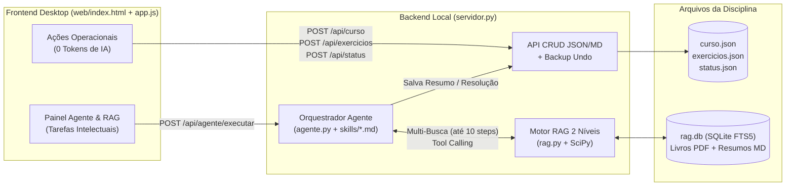

# 📚 Plataforma Multi-Disciplinas de Estudos (Desktop Local)

Plataforma web local (`127.0.0.1`), 100% *data-driven* (orientada a JSON e Markdown), projetada para gerenciar disciplinas universitárias com **custo zero de tokens em tarefas operacionais** e **Agente de IA local com RAG Estruturado em 2 níveis** para tarefas intelectuais (resumos de aulas, tutoria progressiva de exercícios sem gabarito e revisão de provas).

---

## 🚀 Como Iniciar

1. Na raiz do projeto, dê dois cliques em **`abrir.bat`** (ou execute `python "Calculo 2/_app/servidor.py"` no terminal).
2. O servidor local iniciará automaticamente em **`http://127.0.0.1:8780/`** e abrirá seu navegador.
3. Para usar o Agente Gemini via API (além do modo gratuito de copiar o pacote RAG + Skill), clique em **`🤖 Agente & RAG`** no topo da página e insira sua `GEMINI_API_KEY` (salva localmente em `_app/dados/.config.json`, ignorada pelo Git).

---

## 📂 Estrutura de Pastas do Projeto

O repositório segue uma arquitetura **Multi-Disciplinas**: cada pasta na raiz (como `Calculo 2/`) representa uma cadeira independente, enquanto o motor da aplicação fica em `_app/`.

```text
Refatoração Site Estudos/
├── abrir.bat                           # Atalho principal: inicia o servidor e abre o navegador
├── .gitignore                          # Protege .env.local (API Key), __pycache__ e pilhas de undo
├── README.md                           # Este guia geral da estrutura e funcionamento
├── docs/                               # Documentação técnica para manutenção a longo prazo
│   ├── ARQUITETURA_E_FUNCIONAMENTO.md  # Funcionamento interno (Servidor, JSONs, RAG 2 níveis e Agente)
│   ├── ANALISE_COMPUTACIONAL_CUSTOS_E_LATENCIA.md # Raio-X de API calls, tokens, custos (US$/R$) e delays
│   └── FLUXO_GIT_E_MANUTENCAO.md       # Árvore de branches (main/dev), convenções e comandos Git
│
└── Calculo 2/                          # Pasta da Disciplina (novas cadeiras seguem este mesmo molde)
    ├── COMO-USAR.md                    # Guia rápido da disciplina
    ├── SKILL-DISCIPLINA.md             # Contexto pedagógico específico da cadeira injetado no Agente
    ├── status.json                     # Marcações dos exercícios (ok = acertei, dub = dúvida, err = errei)
    │
    ├── disciplina/                     # Documentos oficiais da turma (PDFs e textos extraídos)
    │   ├── programa/                   # Programa oficial da disciplina e datas das provas
    │   ├── listas-2026-1/              # PDFs das listas oficiais do semestre
    │   ├── provas-antigas/             # Acervo de provas anteriores para revisão
    │   └── textos-extraidos/           # Cache de texto extraído dos PDFs da disciplina
    │
    ├── livros/                         # Bibliografia em PDF (servida localmente com #page=N)
    │   ├── Calculo - James Stewart - 7 Edição - Volume 2.pdf
    │   ├── Guidorizzi H. L.   Um curso de cálculo vol 2 (2013).pdf
    │   ├── Calculo com Geometria analitica vol 1 - Louis Leithold 3ªed.pdf
    │   └── Stewart_1_ptbr.pdf
    │
    ├── resumos/                        # Resumos teóricos em Markdown (renderizados com KaTeX na UI)
    │   ├── aula-01-a-04-espaco-r3-superficies-cilindricas-revolucao-quadricas.md
    │   ├── aula-05-curvas-no-r3-limites-continuidade-derivadas.md
    │   ├── aula-06-a-08-funcoes-varias-variaveis-limite-continuidade-derivadas-parciais.md
    │   ├── aula-09-a-14-diferenciabilidade-regra-da-cadeia-gradiente-extremos-lagrange.md
    │   └── area-2-aulas-16-a-18-integrais-duplas-iteradas-mudanca-de-variaveis.md
    │
    ├── resolucoes/                     # Guias e resoluções passo a passo em Markdown
    │   └── guia-resolucao-exerc-15-4.md
    │
    ├── exercicios/                     # Espelho legível em Markdown do progresso dos exercícios
    │   ├── STATUS.md                   # Gerado automaticamente a cada clique de marcação (✓, ?, ✗)
    │   └── lista-mestra.md
    │
    └── _app/                           # ⚙️ MOTOR DA PLATAFORMA (Backend + RAG + Agente + UI)
        ├── abrir.bat                   # Inicializador direto do servidor
        ├── servidor.py                 # Servidor HTTP + API REST + Descoberta Multi-Disciplinas
        ├── rag.py                      # Motor RAG em 2 níveis (SQLite FTS5 BM25 + PDF + SciPy)
        ├── agente.py                   # Orquestrador do Agente Gemini com Function Calling (até 10 buscas)
        ├── LEIAME.md                   # Documentação rápida do motor _app
        ├── .env.local                  # [IGNORADO PELO GIT] Chave GEMINI_API_KEY e modelo padrão
        │
        ├── dados/                      # Banco de dados estruturado da disciplina
        │   ├── curso.json              # Cabeçalho, Unidades (1, 2, 3), Onde Estamos, Cronograma e Fórmulas
        │   ├── exercicios.json         # Seções de exercícios, enunciados, travas (locked) e páginas PDF
        │   └── rag.db                  # Índice SQLite FTS5 (secoes_completas + chunks_fts)
        │
        ├── skills/                     # Skills modulares globais do Agente IA
        │   ├── resumidor-aula.md       # Gera resumos didáticos conectando slides e seção do livro
        │   ├── tutor-progressivo.md    # Tutor em 4 níveis (Dica -> Guiado -> Auditoria -> Completo)
        │   ├── estrategista-revisao.md # Analisa erros/dúvidas e provas antigas para plano de ataque
        │   └── importador-material.md  # Auxilia na catalogação de novos materiais
        │
        ├── img/                        # Figuras extraídas dos PDFs para exibição nos cartões de exercício
        │
        └── web/                        # Frontend SPA (Vanilla HTML5 + CSS3 + JS ES6 + KaTeX)
            ├── index.html              # Estrutura da aplicação e modais interativos
            ├── estilo.css              # Design system (modo claro/escuro, layout responsivo desktop)
            └── app.js                  # Renderização dinâmica, CRUD zero-token e cliente do Agente/RAG
```

---

## 🧠 Visão Rápida da Arquitetura



---

## 📖 Documentação Completa

Para detalhes técnicos de manutenção e fluxo de versionamento, consulte a pasta [`docs/`](./docs/):

1. **[`docs/ARQUITETURA_E_FUNCIONAMENTO.md`](./docs/ARQUITETURA_E_FUNCIONAMENTO.md)** — Como funcionam os schemas JSON, as rotas da API, o RAG em 2 níveis (incluindo a resolução de exercícios pares do Stewart sem gabarito) e o loop de *Function Calling* do Agente.
2. **[`docs/ANALISE_COMPUTACIONAL_CUSTOS_E_LATENCIA.md`](./docs/ANALISE_COMPUTACIONAL_CUSTOS_E_LATENCIA.md)** — Análise computacional completa dos fluxos, efeito cumulativo de tokens por turno, tabelas de preços de API (US\$ e R\$) e origem de cada milissegundo de latência (disco/SQLite/SciPy vs. rede/inferência).
3. **[`docs/FLUXO_GIT_E_MANUTENCAO.md`](./docs/FLUXO_GIT_E_MANUTENCAO.md)** — Árvore do Git (`main` + `dev`), convenção de commits e guia passo a passo para evoluir o código sem misturar com o progresso diário de estudos.

---

## 🧱 Novo motor (em construção — refatoração v3)

O motor novo (`_app/backend`, FastAPI + SQLite por matéria) está sendo construído **ao lado** do app atual, seguindo
[`docs/superpowers/specs/2026-10-20-refatoracao-plataforma-design.md`](./docs/superpowers/specs/2026-10-20-refatoracao-plataforma-design.md).
Enquanto a interface nova não fica pronta (Fase 5), o app atual (`abrir.bat`, porta 8780) continua sendo o de uso diário.

- **Iniciar o motor novo:** dois cliques em `_app/abrir-novo.bat` (cria o ambiente Python na primeira vez). Sobe em
  `http://127.0.0.1:8790` e abre a documentação interativa da API em `/docs`.
- **Rodar os testes:** dentro de `_app/backend`, `.venv/Scripts/python -m pytest`.
- **Configuração:** `_app/config.toml` (porta, limiares de confiança da importação, tamanho do histórico de desfazer).
- **Importar materiais (sem IA):** `POST /api/materias/{uid}/importacoes` com o PDF (programa, calendário, informações
  da turma, livro, lista de exercícios, slides, prova). A plataforma classifica o arquivo, extrai unidades, datas de
  prova, tópicos, sumário do livro, questões e critérios por regras, liga tópicos ↔ seções ↔ listas por similaridade e
  devolve uma **proposta** para revisar (itens com pouca confiança vêm marcados com `"revisar": true`). Nada é gravado
  até `POST …/importacoes/{id}/confirmar`; reimportar uma lista só acrescenta questões (modo `mesclar`), sem apagar marcações.
- **Migrar de novo antes do corte:** enquanto o app atual for o de uso diário, as marcações e edições feitas nele
  podem ser trazidas para o motor novo com `python -m estudos.migracao "../../Calculo 2"` (dentro de `_app/backend`, com o
  ambiente ativo). A matéria nova é reconstruída a partir do legado, mantendo o mesmo identificador; o resultado sai em
  `Calculo 2/.migracao/relatorio.md`. Se já houver ações feitas no app novo, a migração recusa (use `--forcar` para descartá-las).
