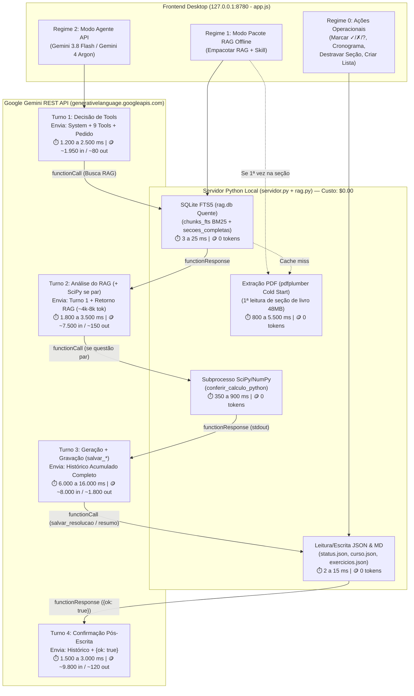
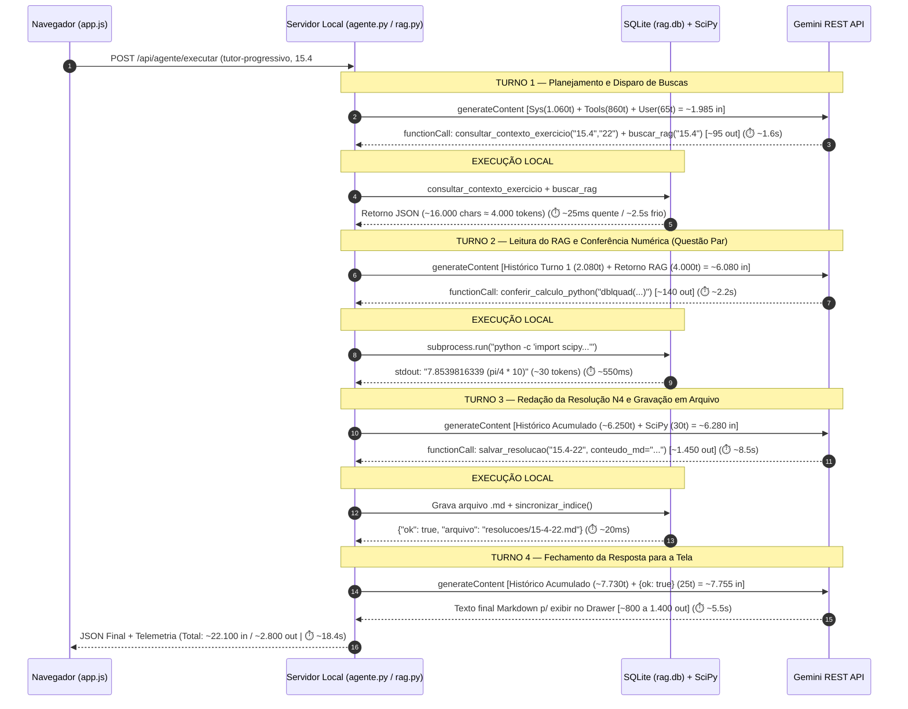

# 🔬 Análise Computacional: Fluxos, API Calls, Uso de Tokens, Custos e Latência

Este documento apresenta o **raio-X computacional completo** da Plataforma Multi-Disciplinas de Estudos (`_app/servidor.py`, `_app/rag.py`, `_app/agente.py` e `_app/web/app.js`), detalhando exatamente o que acontece por baixo dos panos em cada fluxo, de onde vem cada milissegundo de latência (CPU/Disco local vs. Rede/Inferência Gemini API) e como os tokens e custos financeiros (US\$ e R\$) se acumulam a cada rodada de *Function Calling*.

---

## 1. Visão Geral dos 3 Regimes de Execução

A plataforma divide todas as interações do usuário em **três regimes computacionais**:

1. **Regime 0 — Operações Determinísticas Locais (`0 API Calls` · `0 Tokens` · `US$ 0.00`):**
   - Marcação de exercícios (`✓`, `✗`, `?`), adição/edição de tópicos em *"Onde estamos"*, edição do *Cronograma*, adição de cartões ao *Formulário*, destravamento de seções e extração de questões de PDFs via `pdfplumber` + regex.
2. **Regime 1 — Modo Pacote RAG Offline (`0 API Calls` · `0 Tokens Cobrados` · `US$ 0.00`):**
   - O motor local (`montar_pacote_rag_enxuto` em `_app/agente.py`) executa as buscas no SQLite FTS5 (`rag.db`) na CPU local e monta um prompt cirúrgico pronto para copiar e colar em qualquer chat externo.
3. **Regime 2 — Modo Agente via Gemini REST API (`1 a 10 API Calls` · Multi-Busca com *Function Calling*):**
   - O orquestrador (`executar_agente` em `_app/agente.py`) realiza chamadas HTTP `POST` para `generativelanguage.googleapis.com/v1beta/models/{modelo}:generateContent`, executando tools locais entre um turno e outro até concluir a tarefa.

---

## 2. Anatomia do Uso de Tokens no Modo Agente API (`_app/agente.py`)

A API REST `generateContent` da Gemini é **stateless** (não guarda sessão no servidor entre chamadas). Por isso, no loop `for passo in range(10):` de `executar_agente()`, cada novo turno reenvia:
1. O bloco fixo de instruções de sistema (`systemInstruction`);
2. A lista completa de declarações de ferramentas (`tools`);
3. Todo o vetor `contents` acumulado desde o Turno 1 (pergunta inicial + todas as chamadas `functionCall` + todos os JSONs de `functionResponse` retornados pelo RAG).

### 2.1. O "Piso Fixo" de Input por Chamada HTTP (`~1.700 a 1.940 tokens/turno`)

Toda chamada HTTP enviada por `_chamar_gemini_rest()` começa com a seguinte estrutura base antes de contabilizar o histórico da conversa:

| Componente do Payload | Origem no Código | Tamanho Real (Caracteres) | Tokens (`~4 chars/tok`) | Explicação |
| :--- | :--- | :---: | :---: | :--- |
| **Prompt Base do Agente** | `_app/agente.py` (linhas 649–658) | `~540 chars` | **`~135 tok`** | Diretrizes gerais de uso obrigatório do RAG e validação numérica via `scipy`. |
| **Skill Ativa (`.md`)** | `_app/skills/<skill>.md` | `~900 – 1.850 chars` | **`~225 – 460 tok`** | `tutor-progressivo.md` (~460 tok), `resumidor-aula.md` (~370 tok), `estrategista-revisao.md` (~260 tok), `importador-material.md` (~225 tok). |
| **Regras da Disciplina** | `SKILL-DISCIPLINA.md` | `~1.920 chars` | **`~480 tok`** | Critérios de correção do Prof. Henrique Araújo, offsets dos livros e perfil do estudante. |
| **Declarações das 9 Tools** | `GEMINI_TOOLS_DECLARATIONS` (`_app/agente.py`) | `~3.450 chars` | **`~860 tok`** | JSON Schema das 9 ferramentas (`ler_secao_livro`, `buscar_rag`, `consultar_contexto_exercicio`, `conferir_calculo_python`, `ler_status_erros`, `salvar_resumo`, `salvar_resolucao`, `adicionar_formula`, `propor_ajuste_cronograma`). |
| **PISO FIXO TOTAL POR TURNO** | `systemInstruction + tools` | **`~6.810 – 7.760 chars`** | **`~1.700 – 1.940 tok`** | **Cobrado como `inputTokens` em cada turno HTTP do loop.** |

---

### 2.2. Volume de Contexto Injetado por Cada Tool Local (`functionResponse`)

Quando o modelo decide chamar uma ferramenta, `executar_tool_local()` consulta o banco SQLite ou executa um script e devolve um dicionário Python serializado em JSON dentro de `contents`:

| Tool Local | O que é retornado no JSON | Tamanho Típico (Chars) | Impacto no Histórico (`Tokens`) |
| :--- | :--- | :---: | :---: |
| **`consultar_contexto_exercicio(secao, numero)`** | Enunciado de `exercicios.json` + resolução existente (se houver) + `1.550 chars` da bateria do PDF (com vizinhos ímpares) + gabarito oficial dos ímpares + **2 unidades de resumo correlato** via `buscar_rag(top_k=2)` | `5.500 – 11.000 chars` | **`+1.375 a +2.750 tok`** |
| **`ler_secao_livro(livro, secao, foco)`** | Texto integral das páginas da seção no livro (ex.: Stewart §15.4 possui 6 páginas = `~18.500 chars`; §14.3 possui 12 páginas = `~34.000 chars`), sem corte de palavras | `14.000 – 34.000 chars` | **`+3.500 a +8.500 tok`** |
| **`buscar_rag(consulta, secao, tipo, top_k=5)`** | Até `top_k` blocos semânticos (subseções `##` de resumos, páginas de listas em PDF ou exemplos de livros ordenados por score BM25) | `4.000 – 12.000 chars` | **`+1.000 a +3.000 tok`** |
| **`ler_status_erros(unidade)`** | Estatísticas por seção + lista completa de questões com `err` (✗) e `dub` (?) contendo enunciado e função matemática | `1.800 – 6.000 chars` | **`+450 a +1.500 tok`** |
| **`conferir_calculo_python(codigo_python)`** | `{ "ok": true, "stdout": "...", "stderr": "" }` | `60 – 250 chars` | **`+20 a +65 tok`** |
| **`salvar_resolucao` / `salvar_resumo`** | `{ "ok": true, "arquivo": "..." }` (retorno curto, mas o `functionCall` gerado pelo modelo no turno anterior contém o texto `.md` completo e permanece no `contents`!) | `80 – 120 chars` *(retorno)* | **`+25 tok`** *(retorno)* + **`+800 a +2.500 tok`** *(do `functionCall` no histórico)* |

---

### 2.3. Equação do Efeito Acumulativo ("Bola de Neve") em Multi-Turn Function Calling

Seja $K$ o número total de chamadas HTTP `generateContent` até o agente finalizar a resposta. No turno $k \in \{1, \dots, K\}$, o total de tokens de entrada (`promptTokenCount`) cobrado pela API é:

$$\text{InputTokens}_k = \underbrace{T_{\text{sys}} + T_{\text{tools}} + T_{\text{user}}}_{\text{Base Inicial } B_0 \approx 1.950\text{ tok}} + \sum_{j=1}^{k-1} \left( T_{\text{out}, j} + T_{\text{toolResp}, j} \right)$$

Somando todos os $K$ turnos da execução, o consumo total de **Input Tokens** da tarefa é:

$$\text{InputTotal} = K \cdot B_0 + \sum_{j=1}^{K-1} (K - j) \cdot \left( T_{\text{out}, j} + T_{\text{toolResp}, j} \right)$$

#### Consequência Prática da Fórmula:
- Todo bloco grande retornado pelo RAG no **Turno 1** ($j = 1$) é multiplicado por $(K - 1)$!
- Se uma execução tem $K = 4$ turnos (ex.: Turno 1 busca no RAG $\to$ Turno 2 roda `scipy` $\to$ Turno 3 chama `salvar_resolucao` $\to$ Turno 4 escreve a mensagem final) e o Turno 1 retornou `5.000 tokens` do livro/exercício, esses mesmos `5.000 tokens` são enviados e cobrados nos Turnos 2, 3 e 4 (**$3 \times 5.000 = 15.000\text{ input tokens}$**).

---

### 2.4. Rastreamento Turno a Turno de um Caso Real (`Tutor Progressivo N4` em Questão Par)

---

## 3. Mapa de Latência: De Onde Vem Cada Delay de Tempo

A latência percebida pelo usuário em qualquer operação é a soma de **componentes locais (Disco/CPU)** e **componentes remotos (Rede/TPU)**:

$$\Delta t_{\text{total}} = \Delta t_{\text{syncRAG}} + \Delta t_{\text{SQLite/PDF}} + \Delta t_{\text{SciPy}} + \sum_{k=1}^{K} \left( \Delta t_{\text{TCP/TLS}, k} + \Delta t_{\text{TTFT}, k} + \frac{\text{OutputTokens}_k + \text{ThinkingTokens}_k}{\text{ Velocidade (tok/s) }} \right)$$

| Camada / Operação | Onde Executa | Tempo Medido | Explicação Detalhada da Origem do Delay |
| :--- | :---: | :---: | :--- |
| **1. Carregamento e CRUD da UI (`/api/dados`, `/api/status`, `/api/curso`)** | Disco Local (`servidor.py`) | **`3 – 18 ms`** | Leitura/escrita direta de arquivos JSON e `.md` na pasta local. Praticamente instantâneo. |
| **2. Varredura Incremental de Índice (`sincronizar_indice`)** | Disco + SQLite (`rag.py`) | **`10 – 35 ms`** | Compara o `st_mtime` de ~45 arquivos `.md` e `.pdf` com a tabela `meta_arquivos`. *(Nota: `consultar_contexto_exercicio` chama `sincronizar_indice` na entrada e chama `buscar_rag` duas vezes, que por sua vez chamam `sincronizar_indice` novamente, somando ~30–60 ms).* |
| **3. Busca Textual BM25 (`chunks_fts` no `rag.db`)** | SQLite FTS5 (`rag.py`) | **`1 – 4 ms`** | Índice invertido FTS5 em memória/SSD com tokenizador `unicode61`. |
| **4. Leitura de Seção de Livro — *Warm Cache*** | SQLite (`secoes_completas`) | **`2 – 8 ms`** | Quando a seção do Stewart/Guidorizzi já foi lida pelo menos uma vez, o texto completo já está salvo na tabela `secoes_completas` do `rag.db`. |
| **5. Leitura de Seção de Livro — *Cold Start* (1ª vez na seção)** | CPU Local (`pdfplumber`) | **`900 – 2.400 ms`** | Na **primeira vez** que uma seção é pedida, `pdfplumber` abre o PDF do livro (`48,7 MB` no Stewart), navega até `pgPdf..pgFimPdf` (6 a 12 páginas) e extrai o texto caractere por caractere aplicando limpeza de acentos LaTeX (`_LATEX_COMBINING`). Salva no `rag.db` para nunca mais repetir. |
| **6. Extração do Apêndice de Gabarito — *Cold Start* (1ª vez no livro)** | CPU Local (`pdfplumber`) | **`3.200 – 5.800 ms`** | Na **primeira vez** que qualquer seção de um livro pede gabarito e a tabela `paginas_gabarito` está vazia para aquele livro, `_extrair_gabarito_secao_livro()` extrai todas as páginas do apêndice (págs. 614–643 no Stewart = 30 páginas) e grava em `paginas_gabarito`. Nas chamadas seguintes, cai para **`~3 ms`**. |
| **7. Verificação Numérica (`conferir_calculo_python`)** | Subprocesso Windows (`python.exe`) | **`380 – 850 ms`** | O cálculo numérico de `dblquad`/`tplquad` leva `< 15 ms`, mas criar um processo filho via `subprocess.run([sys.executable, "-c", ...])` e importar `numpy` + `scipy.integrate` do zero leva **~400 a 800 ms** no Windows. |
| **8. Handshake de Rede TCP + TLS por Turno** | Rede (`urllib.request`) | **`180 – 350 ms` / turno** | `urllib.request.urlopen()` abre uma nova conexão HTTPS a cada turno do loop (sem reutilizar socket *keep-alive*), pagando 2 RTTs (TCP + TLS 1.3) até `generativelanguage.googleapis.com`. |
| **9. Inferência na Gemini API (Prefill + Thinking + Decode)** | Google Cloud TPUs | **`1.200 – 15.000 ms` / turno** | **É responsável por ~85% a 95% do tempo total no modo API.** Turnos curtos de decisão de tool (`~90 out tokens`) levam `1,2s – 2,5s`. Turnos longos que redigem um resumo inteiro ou resolução N4 (`1.500 a 3.000 out tokens`) levam `8,0s – 16,0s` devido à geração sequencial de tokens. |

---

## 4. Tabela Oficial de Custos de API por Fluxo (US\$ e R\$)

### 4.1. Preços Oficiais Google Gemini API (`ai.google.dev/gemini-api/docs/pricing` — Por 1M de Tokens, Cotação `US$ 1,00 = R$ 5,80`)

> [!IMPORTANT]
> Tanto o **Gemini 4 Argon** quanto o **Gemini 3.8 Flash** contam atualmente com **tarifa promocional de lançamento** na API oficial da Google, passando para a **tarifa padrão** ao fim da janela promocional. O motor `_app/agente.py` já aplica automaticamente a tarifa oficial exata de cada modelo e vira a chave na data de transição.

| Modelo Oficial | Vigência da Tarifa | Preço Input (1M tok) | Preço Output + Thinking (1M tok) | Preço Context Cache (1M tok) | Free Tier |
| :--- | :---: | :---: | :---: | :---: | :---: |
| **`gemini-3.8-flash`** *(Promocional Vigente)* | **Até 31/12/2026** | **US\$ 0,75** *(R\$ 4,35)* | **US\$ 3,75** *(R\$ 21,75)* | **US\$ 0,075** *(R\$ 0,44)* | **Sim** *(Gratuito dentro do rate limit)* |
| **`gemini-3.8-flash`** *(Tarifa Padrão)* | **A partir de 01/01/2027** | **US\$ 1,50** *(R\$ 8,70)* | **US\$ 7,50** *(R\$ 43,50)* | **US\$ 0,150** *(R\$ 0,87)* | **Sim** |
| **`gemini-4-argon`** *(Promocional Vigente)* | **Até 30/11/2026** | **US\$ 2,00** *(R\$ 11,60)* | **US\$ 10,00** *(R\$ 58,00)* | **US\$ 0,100** *(R\$ 0,58)* | **Não** *(Somente Paid Tier)* |
| **`gemini-4-argon`** *(Tarifa Padrão)* | **A partir de 01/12/2026** | **US\$ 4,00** *(R\$ 23,20)* | **US\$ 20,00** *(R\$ 116,00)* | **US\$ 0,200** *(R\$ 1,16)* | **Não** *(Somente Paid Tier)* |
| **`gemini-2.5-pro`** *(Fallback legado)* | Permanente | **US\$ 1,25** *(R\$ 7,25)* | **US\$ 10,00** *(R\$ 58,00)* | **US\$ 0,3125** *(R\$ 1,81)* | Sim (limitado) |
| **`gemini-2.5-flash`** *(Fallback legado)* | Permanente | **US\$ 0,30** *(R\$ 1,74)* | **US\$ 2,50** *(R\$ 14,50)* | **US\$ 0,075** *(R\$ 0,44)* | Sim |

---

### 4.2. Custo Detalhado por Operação na Plataforma (Paid Tier)

*(Na tabela abaixo, o valor principal reflete a **tarifa oficial vigente hoje** e o valor entre parênteses mostra a **tarifa padrão cheia pós-promoção**).*

| Fluxo / Tarefa | API Calls (Turnos) | Input Tokens Acumulados | Output + Thinking Tokens | Latência Total (Cache Quente) | Custo **`gemini-3.8-flash`** Vigente *(Padrão 2027+)* | Custo **`gemini-4-argon`** Vigente *(Padrão Dez/2026+)* |
| :--- | :---: | :---: | :---: | :---: | :---: | :---: |
| **1. Operações de Interface** *(Marcar questão, editar cronograma, criar lista de PDF)* | `0` | `0` | `0` | `5 – 400 ms` | **US\$ 0,0000** **R\$ 0,000** | **US\$ 0,0000** **R\$ 0,000** |
| **2. Modo Pacote RAG Offline** *(Montar prompt com RAG p/ copiar)* | `0` | `0` *(gera ~4.5k tok locais)* | `0` | `25 – 60 ms` | **US\$ 0,0000** **R\$ 0,000** | **US\$ 0,0000** **R\$ 0,000** |
| **3. Tutor Progressivo `N1` / `N2`** *(Dica ou Caminho sem salvar arquivo)* | `2` | `~6.800 tok` | `~350 tok` | `3,0 – 5,5 s` | **US\$ 0,0064** *(US\$ 0,0128)* **R\$ 0,037** *(R\$ 0,074)* | **US\$ 0,0171** *(US\$ 0,0342)* **R\$ 0,099** *(R\$ 0,198)* |
| **4. Tutor Progressivo `N3`** *(Esboço com validação `scipy`)* | `3` | `~13.500 tok` | `~750 tok` | `6,5 – 10,5 s` | **US\$ 0,0129** *(US\$ 0,0259)* **R\$ 0,075** *(R\$ 0,150)* | **US\$ 0,0345** *(US\$ 0,0690)* **R\$ 0,200** *(R\$ 0,400)* |
| **5. Tutor Progressivo `N4` Completo** *(Questão par + `scipy` + `salvar_resolucao`)* | `3 a 4` | `~21.000 tok` | `~2.500 tok` | `12,0 – 20,0 s` | **US\$ 0,0251** *(US\$ 0,0503)* **R\$ 0,146** *(R\$ 0,291)* | **US\$ 0,0670** *(US\$ 0,1340)* **R\$ 0,389** *(R\$ 0,777)* |
| **6. Gerador de Resumo (`resumidor-aula`)** *(Seção do livro + RAG + `salvar_resumo` + `adicionar_formula`)* | `3 a 4` | `~26.000 tok` | `~3.400 tok` | `15,0 – 25,0 s` | **US\$ 0,0323** *(US\$ 0,0645)* **R\$ 0,187** *(R\$ 0,374)* | **US\$ 0,0860** *(US\$ 0,1720)* **R\$ 0,499** *(R\$ 0,998)* |
| **7. Estrategista de Revisão (`estrategista-revisao`)** *(Diagnóstico de erros + ajuste de cronograma)* | `2 a 3` | `~10.000 tok` | `~1.100 tok` | `5,5 – 9,5 s` | **US\$ 0,0116** *(US\$ 0,0233)* **R\$ 0,067** *(R\$ 0,135)* | **US\$ 0,0310** *(US\$ 0,0620)* **R\$ 0,180** *(R\$ 0,360)* |

---

### 4.3. Simulação de Custo de Uso Mensal Intenso (1 Semestre / 1 Unidade Completa)

Supondo que durante um mês inteiro de estudos intensos para uma prova você execute via API (no Paid Tier):
- **60 atualizações de marcação/cronograma/listas** $\to$ `60 × R$ 0,00 = R$ 0,00`
- **8 resumos teóricos completos de seções novas (`resumidor-aula`)** $\to$ `8 × R$ 0,187 (Flash) = R$ 1,50` *(ou `8 × R$ 0,499 = R$ 3,99` no Argon)*
- **30 pedidos de dicas rápidas `N1`/`N2` (`tutor-progressivo`)** $\to$ `30 × R$ 0,037 (Flash) = R$ 1,11` *(ou `30 × R$ 0,099 = R$ 2,97` no Argon)*
- **25 resoluções completas `N4` gravadas em arquivo (`tutor-progressivo`)** $\to$ `25 × R$ 0,146 (Flash) = R$ 3,65` *(ou `25 × R$ 0,389 = R$ 9,73` no Argon)*
- **6 diagnósticos de revisão (`estrategista-revisao`)** $\to$ `6 × R$ 0,067 (Flash) = R$ 0,40` *(ou `6 × R$ 0,180 = R$ 1,08` no Argon)*

> **Custo Total Mensal Usando `gemini-3.8-flash`:** **~US\$ 1,15 / mês (R\$ 6,66 / mês)** na tarifa vigente *(ou R\$ 13,32 / mês na tarifa padrão 2027+, e **R\$ 0,00** se usado no Free Tier do Google AI Studio)*.
> **Custo Total Mensal Usando `gemini-4-argon` em tudo:** **~US\$ 3,06 / mês (R\$ 17,77 / mês)** na tarifa vigente até 30/11/2026 *(ou **US\$ 6,12 / R\$ 35,54 / mês** na tarifa padrão pós-01/12/2026)*.
> *(No modelo antigo sem separação de dados e sem RAG SQLite, esse mesmo volume consumiria ~5,5 milhões de tokens em sessões monolíticas de código, custando entre **R\$ 120,00 e R\$ 240,00 / mês**).*

---

## 5. Painel de Telemetria em Tempo Real na Interface

Toda execução realizada no Drawer **`🤖 Agente, RAG em 2 Níveis & Skills`** retorna o objeto enriquecido `telemetria` e registra uma entrada auditável em `_app/dados/.historico_telemetria.json` (consultável via `GET /api/telemetria`), exibindo diretamente na tela:
1. **Divisão do Tempo Total (`ms` e `%`):** Tempo de Rede/Inferência na Gemini API vs. Tempo Local (SQLite FTS5 + PDF + SciPy);
2. **Decomposição do Contexto Base:** Quantos tokens vieram do `System + Skills`, das `Declarações de Tools` e do `Pedido do Usuário`;
3. **Tabela Turno a Turno (API Calls):** Cada chamada HTTP numerada com `Input Tokens`, `Output Tokens`, `Thinking Tokens`, `Latência (ms)`, `Tools Disparadas` e `Custo (US$ / R$)`;
4. **Acumulado Histórico da Disciplina:** Total de chamadas de API, tokens e custo acumulado no projeto.
