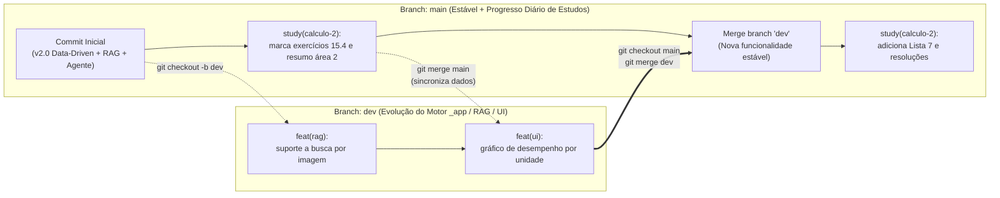

# 🌿 Fluxo Git, Árvore de Branches e Manutenção a Longo Prazo

Como este repositório armazena tanto **os seus dados vivos de estudo** (marcações de exercícios, resumos, listas novas, PDFs) quanto **o código-fonte do motor da plataforma (`_app/`)**, adotamos uma árvore Git de **duas branches principais (`main` e `dev`)** para garantir que testes de novas funcionalidades nunca quebrem seu ambiente de estudo em época de prova.

---

## 1. Visualização da Árvore do Git (`main` vs `dev`)



### Papel de cada Branch:

| Branch | Quando usar? | O que é editado nela? |
| :--- | :--- | :--- |
| **`main`** | **No dia a dia dos estudos (95% do tempo).** É a branch que fica ativa enquanto você assiste aulas, resolve listas, gera resumos e usa o site. | `status.json`, `exercicios/STATUS.md`, `curso.json`, `exercicios.json`, `resumos/*.md`, `resolucoes/*.md`, `disciplina/**`, `livros/**` |
| **`dev`** | **Quando for programar melhorias na plataforma.** Use quando quiser alterar o visual (`app.js`, `estilo.css`), criar rotas em `servidor.py` ou mexer no `rag.py` / `agente.py`. | `_app/servidor.py`, `_app/rag.py`, `_app/agente.py`, `_app/web/*`, `_app/skills/*`, `docs/*` |

---

## 2. Convenção de Commits Semânticos

Para manter o histórico (`git log --oneline --graph`) limpo e fácil de entender daqui a vários semestres, use os seguintes prefixos nas mensagens de commit:

- **`study(<disciplina>): ...`** — Atualizações de estudo do dia a dia (ex.: `study(calculo-2): conclui seção 15.4 e adiciona resumo da aula 19`).
- **`feat(<modulo>): ...`** — Nova funcionalidade no motor da plataforma (ex.: `feat(agente): adiciona tool de exportação para PDF`).
- **`fix(<modulo>): ...`** — Correção de bug no código (ex.: `fix(rag): ajusta offset de páginas do Guidorizzi`).
- **`ui: ...`** — Ajustes visuais de layout/CSS em `_app/web/`.
- **`docs: ...`** — Atualizações na documentação (`README.md`, `docs/`, `COMO-USAR.md`).

---

## 3. Receitas Práticas para o Dia a Dia

### 📌 Cenário A: Salvar seu progresso de estudos no fim do dia (na `main`)
Sempre que terminar uma sessão de estudos e quiser salvar no GitHub:
```powershell
git checkout main
git add .
git commit -m "study(calculo-2): avança exercícios da área 2 e atualiza cronograma"
git push origin main
```

### 🛠️ Cenário B: Desenvolver uma melhoria no site/motor (usando a `dev`)
Quando quiser programar uma feature nova sem arriscar travar o site de estudos:
```powershell
# 1. Muda para a branch dev e puxa tudo de mais recente da main
git checkout dev
git merge main

# 2. Faça suas alterações nos arquivos de _app/... e teste no navegador
git add .
git commit -m "feat(ui): adiciona filtro por prioridade nas listas"
git push origin dev

# 3. Ficou 100% testado e aprovado? Traga para a main e volte a estudar!
git checkout main
git merge dev
git push origin main
```

### 💻 Cenário C: Clonar o projeto em outro computador
Como os livros (`livros/*.pdf`) e o índice (`rag.db`) estão versionados no repositório privado, basta rodar:
```powershell
git clone https://github.com/ep-creator/plataforma-estudos.git
cd plataforma-estudos
.\abrir.bat
```
> **Nota de Segurança**: O arquivo `_app/dados/.config.json` (onde fica a sua `GEMINI_API_KEY`) **nunca** sobe para o GitHub por estar protegido no `.gitignore`. Ao clonar em um computador novo, basta clicar em **`🤖 Agente & RAG`** na interface e colar sua chave uma única vez.

---

## 4. O que é Ignorado pelo Git (`.gitignore`)

Para evitar vazamento de credenciais ou arquivos temporários corrompidos, o `.gitignore` bloqueia automaticamente:
1. **`**/.config.json`, `**/.env` e `**/.env.local`** — Sua chave da API do Gemini jamais será enviada ao GitHub.
2. **`**/.historico_undo.json`** — Pilha local temporária do botão "Desfazer".
3. **`**/__pycache__/` e `*.pyc`** — Bytecode compilado do Python.
4. **`*.db-journal`, `*.db-wal`, `*.db-shm`** — Locks temporários do SQLite enquanto o servidor está aberto.
