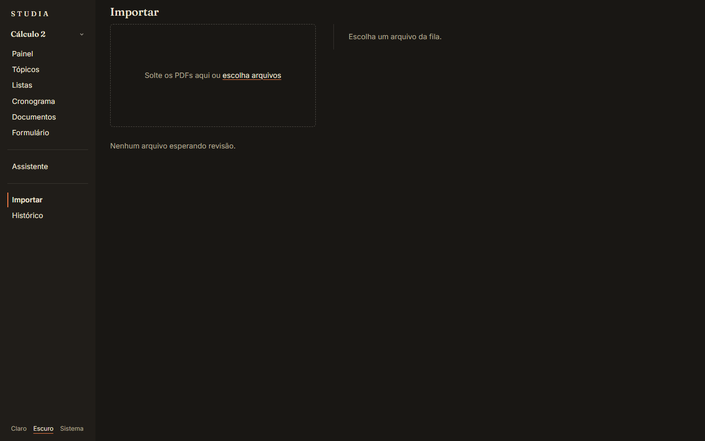
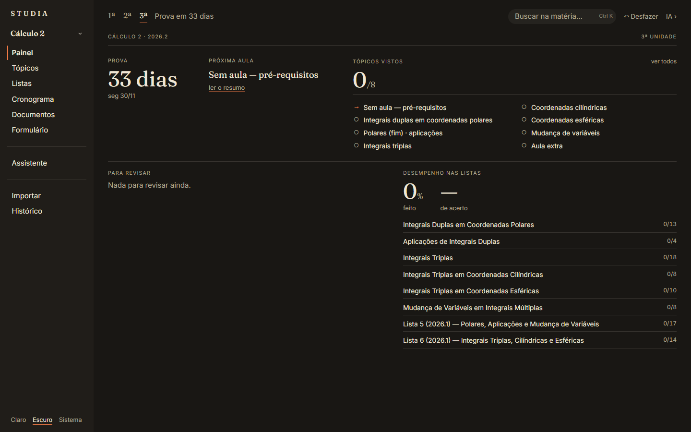
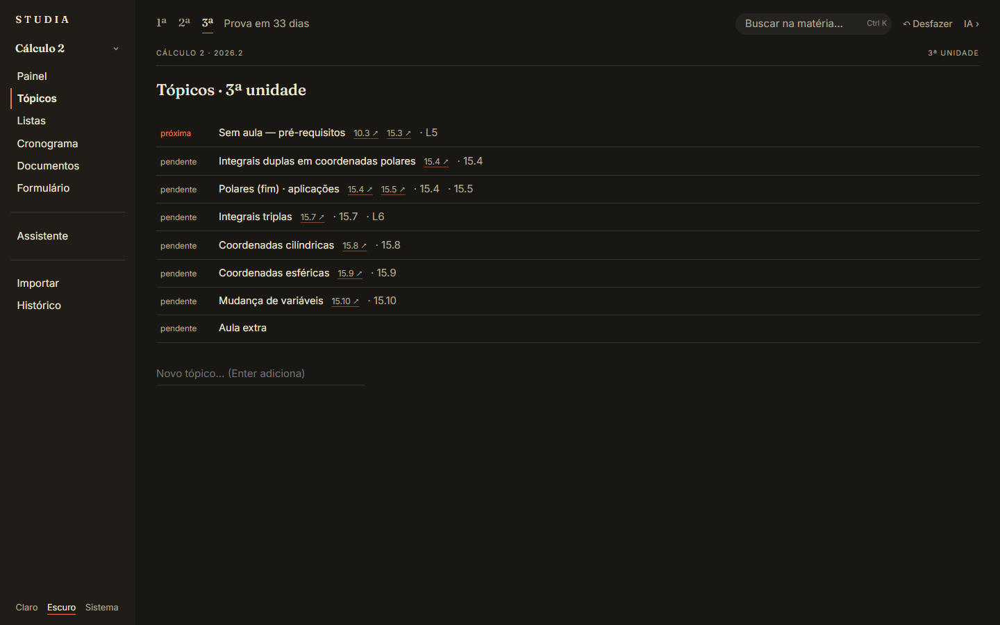
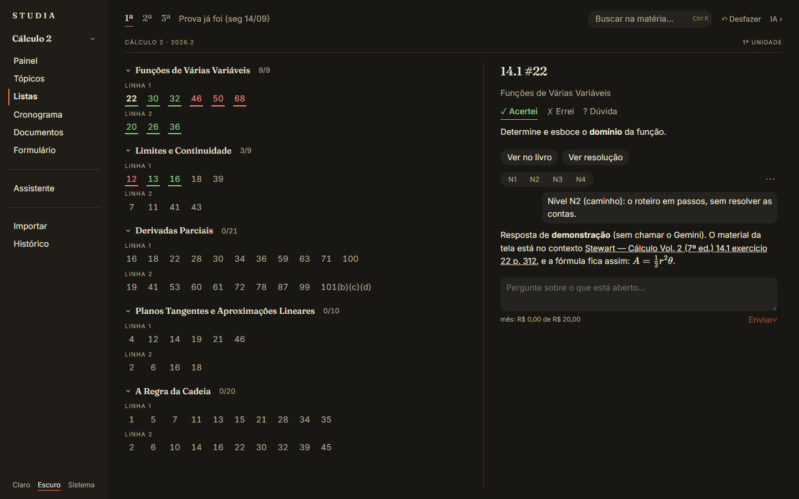
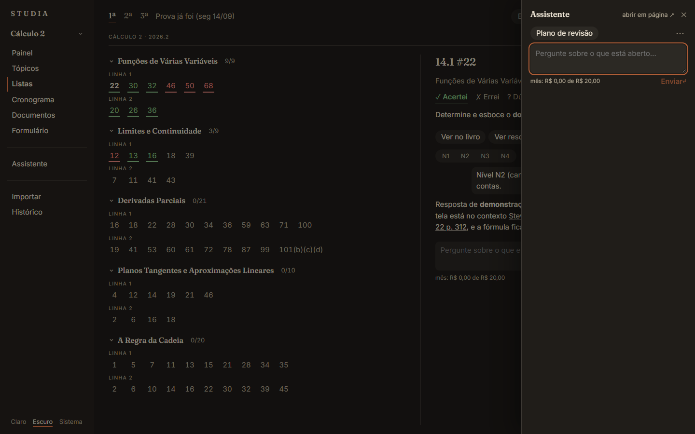

# Guia de uso

[← README](../README.md) · **Guia de uso** · [A ideia do projeto](ideia.md) · [Tecnologia e evolução](tecnologia.md)

---

## Abrir

Dê dois cliques em **`abrir.bat`**, na raiz do projeto. Ele abre uma janela de terminal e o app fica em
**http://127.0.0.1:8790**.

- Na primeira vez, ele cria o ambiente Python do motor e instala as dependências. Isso demora alguns minutos.
- Depois, ele só recompila a interface quando o código mudou, então abrir fica rápido.
- Para fechar, feche a janela do terminal.

Requisitos: **Python 3.13** e **Node.js** (a interface é compilada no seu computador).

Tudo fica na pasta do projeto: nada vai para a nuvem, exceto as perguntas que você fizer ao assistente (elas vão para o
Gemini, se você configurar a chave).

## Criar uma matéria

1. Na tela inicial, clique em **＋ Nova matéria** e dê um nome (ex.: *Cálculo 2*).
2. Vá em **Importar** e solte os PDFs da disciplina na área tracejada: programa, calendário, informações da turma,
   livros, listas de exercícios, slides. Pode mandar tudo de uma vez, em qualquer ordem.
3. Cada arquivo entra na **fila** com um estado:
   - **pronto**: o app entendeu tudo com segurança;
   - **revisar N**: N itens pedem a sua conferência.
4. Clique num arquivo para ver o que o app entendeu (unidades, datas, tópicos, questões, seções do livro). Se o tipo
   estiver errado, troque em **tipo**. Corrija o que precisar e clique em **Confirmar** (ou **descartar**).

Nada é gravado sem a sua confirmação. Itens marcados com **conferir** são os que o app não teve certeza.

Cada matéria vira uma pasta na raiz do projeto, com o banco (`materia.db`), os PDFs (`fontes/`) e os textos
(`conteudo/`).

## As telas da matéria

A barra lateral leva às áreas da matéria. No topo, **1ª 2ª 3ª** trocam de unidade e o texto ao lado diz quanto falta
para a prova.

### Painel

A visão geral da unidade:

- **Prova**: os dias que faltam (ou *feita*, se já passou).
- **Próxima aula**: o tópico marcado como próximo, com um atalho para ler o resumo.
- **Tópicos vistos**: quantos já foram vistos, com cada tópico marcado (✓ visto, → próximo, ○ pendente).
- **Para revisar**: os números das questões que você marcou como errei ou dúvida, por lista. Clicar abre a questão.
- **Desempenho nas listas**: quanto já foi feito e a taxa de acerto, por lista.

### Tópicos

A lista do que cai na prova. Clique no estado (*pendente → próxima → visto*) para avançar. Passe o mouse (ou use Tab)
numa linha para ver **↑ ↓** (reordenar), **editar** e o menu **···** (apagar). Para criar um tópico, escreva no campo
do fim e aperte Enter.

### Listas

À esquerda, as listas da unidade com os números das questões; à direita, a questão aberta.

- **Marcar**: ✓ Acertei, ✗ Errei, ? Dúvida. Clicar de novo na marca ativa desmarca.
- **Teclado**: setas andam entre as questões; **1** acertei, **2** errei, **3** dúvida, **0** limpa.
- **Ver no livro**: o enunciado original do livro e a resposta do gabarito, quando a questão é um exercício do livro.
- **Ver resolução**: a resolução gravada, quando existe (fica escondida até você pedir, para não estragar a tentativa).
- **N1 N2 N3 N4**: pedem ajuda ao assistente, do mais leve ao mais completo (veja abaixo).

### Cronograma

Aulas, provas e as suas sessões de estudo numa linha do tempo. **+ sessão** cria uma sessão; passe o mouse numa
sessão para **marcar feita** ou **editar**.

### Documentos

Resumos, resoluções, planos e anotações (em Markdown, com fórmulas), e também os PDFs da matéria (livros, listas,
slides). Clique para ler; **editar** abre o editor. Num resumo ligado a uma seção do livro, **Resumir a seção** pede ao
assistente um resumo novo.

### Formulário

As fórmulas da unidade, agrupadas por tópico. **+ fórmula** cria uma; **folha para imprimir** abre a impressão das fórmulas, numa folha para levar.

## Buscar

**Ctrl K** abre a busca da matéria inteira (livros, slides, listas, resumos). O resultado abre no lugar certo: o texto
no documento ou o PDF na página.

## Desfazer

Toda alteração fica registrada. **Ctrl Z** (ou **↶ Desfazer** no topo) desfaz a última, em qualquer tela. O
**Histórico** mostra tudo o que mudou, com **detalhes** de cada mudança.

## Assistente (IA)

O assistente usa o **Gemini**, do Google, e precisa de uma chave da API.

### Configurar a chave

1. Crie uma chave de graça no **Google AI Studio**.
2. Abra **Assistente** na barra lateral. No fim da lista de conversas, em **API key**, clique em **colar** (ou
   **trocar**, para corrigir uma chave errada), cole a chave e aperte Enter.

A chave fica em `_app/.segredos.toml`, fora do Git, e nunca volta para a tela.

### Onde usar

| Onde | Atalho | O que faz |
|---|---|---|
| Questão aberta (Listas) | **N1** Dica | só o conceito e o ponto de partida, sem contas |
| | **N2** Caminho | o roteiro em passos, sem resolver as contas |
| | **N3** Esboço | a estrutura com as passagens-chave |
| | **N4** Resolução | a resolução completa, já gravada como documento |
| Documento ligado a uma seção | **Resumir a seção** | escreve (ou melhora) o resumo e cria os cartões de fórmula |
| Painel e página do Assistente | **Plano de revisão** | diagnóstico dos erros e plano até a prova |

Você também pode escrever uma pergunta livre no campo de mensagem.

- **IA ›** no topo abre o assistente numa gaveta por cima da página (Esc fecha). **abrir em página ↗** leva a conversa
  para a página do Assistente, que lista todas as conversas da matéria.
- O assistente **cita** de onde tirou cada coisa (ex.: *[Stewart p. 312]*); clicar na citação abre o livro na página.
- O que ele grava (resolução, resumo, fórmula) aparece na conversa com **Abrir** e **Desfazer**.
- **Custo**: cada resposta mostra quanto custou em reais, e o rodapé mostra o total do mês. Se uma resposta for passar
  do **teto mensal** (R$ 20, ajustável em `_app/config.toml`), o app pede confirmação antes.
- O menu **···** tem **Recomeçar**, que abre uma conversa nova e vazia (a antiga fica guardada).

### Sem chave

Sem chave, o resto do app funciona normalmente: só o assistente fica parado, mostrando a caixa **API key**.

## Tema

No pé da barra lateral: **Claro · Escuro · Sistema** (segue o Windows).

## Problemas comuns

- **"Não encontrei o Python 3.13"**: instale em https://www.python.org/downloads/ e abra de novo.
- **A interface não abre ou aparece antiga**: instale o Node.js (https://nodejs.org) e abra de novo; o `abrir.bat`
  recompila sozinho.
- **"O Gemini recusou a chave"**: o aviso traz o atalho **trocar a chave**.
