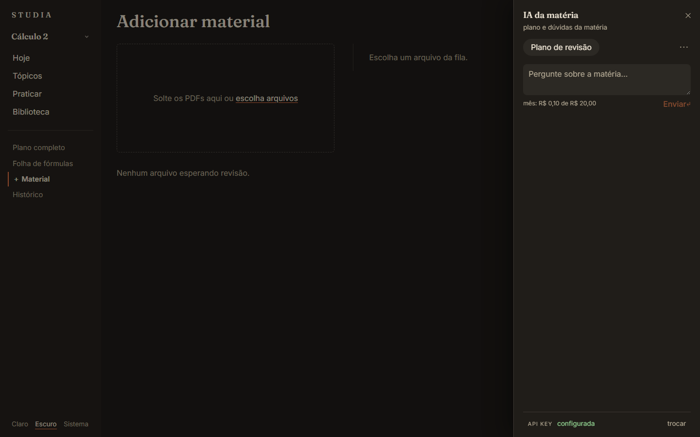
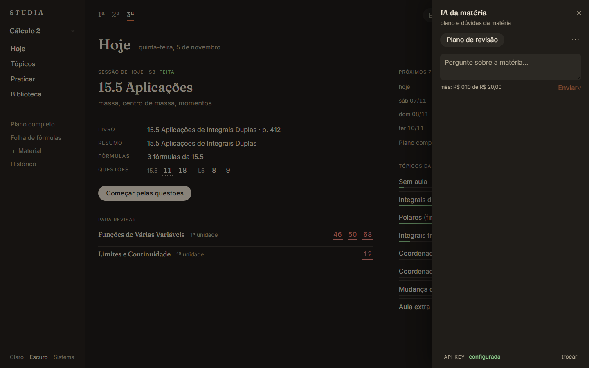

# Guia de uso

[← README](../README.md) · **Guia de uso** · [A ideia do projeto](ideia.md) · [Tecnologia e evolução](tecnologia.md)

---

## Abrir

Dê dois cliques em **`abrir.bat`**, na raiz do projeto. Ele abre uma janela de terminal e o app fica em
**http://127.0.0.1:8790**.

- Na primeira vez, ele cria o ambiente Python do motor e instala as dependências. Isso demora alguns minutos.
- Depois, ele só recompila a interface quando o código mudou, então abrir fica rápido.
- Para fechar, feche a janela do terminal.

Requisitos: **Python 3.13** e **Node.js** (a interface é compilada no seu computador).

Tudo fica na pasta do projeto: nada vai para a nuvem, exceto as perguntas que você fizer ao assistente (elas vão para o
Gemini, se você configurar a chave).

## Criar uma matéria

1. Na tela inicial, clique em **＋ Nova matéria** e dê um nome (ex.: *Cálculo 2*).
2. Vá em **＋ Adicionar material** (a matéria vazia já mostra os três passos) e solte os PDFs da disciplina na área tracejada: programa, calendário, informações da turma,
   livros, listas de exercícios, slides. Pode mandar tudo de uma vez, em qualquer ordem.
3. Cada arquivo entra na **fila** com um estado:
   - **pronto**: o app entendeu tudo com segurança;
   - **revisar N**: N itens pedem a sua conferência.
4. Clique num arquivo para ver o que o app entendeu (unidades, datas, tópicos, questões, seções do livro). Se o tipo
   estiver errado, troque em **tipo**. Corrija o que precisar e clique em **Confirmar** (ou **descartar**).
5. Se o app não achar nada no arquivo (um calendário sem datas, uma lista sem questões), ele diz o que faltou e oferece
   **Guardar como referência**: o PDF vai para a Biblioteca sem criar nada.

Nada é gravado sem a sua confirmação. Itens marcados com **conferir** são os que o app não teve certeza.

Cada matéria vira uma pasta na raiz do projeto, com o banco (`materia.db`), os PDFs (`fontes/`) e os textos
(`conteudo/`).

## As telas da matéria

A barra lateral tem as quatro áreas do estudo — **Hoje**, **Tópicos**, **Praticar** e **Biblioteca** — e, embaixo, o
apoio: **Plano**, **Folha de fórmulas**, **＋ Adicionar material** e **Histórico**. No topo, **1ª 2ª 3ª** trocam de unidade.

O progresso se calcula sozinho: uma sessão conta como **feita** quando todas as questões dela foram marcadas ou
resolvidas (antes disso mostra quantas, ex.: "2 de 3"). Um tópico tem quatro estados: **hoje** (é o da sessão do dia),
**a seguir** (a aula ainda não chegou), e, depois da aula, **em dia** (metade ou mais das questões trabalhadas) ou
**falta praticar** (menos da metade). Uma questão conta como trabalhada quando tem marcação ou uma resolução sua; a
resolução escrita pela IA fica para ler, mas não conta como prática. Não precisa
marcar nada à mão para a tela fazer sentido.

### Hoje

A casa da matéria:

- **Sessão de hoje** (ou a próxima, se hoje não tiver): o foco do plano e o material a um clique — a seção no livro, o
  resumo, as fórmulas e as questões da sessão. **Começar pelas questões** abre a primeira ainda não feita.
- **Para revisar**: as questões que você marcou como errei ou dúvida, **de todas as unidades**. Clicar abre a questão.
- **Próximos 7 dias**: as sessões, aulas e provas. **Plano completo →** abre a linha do tempo inteira.
- **Tópicos para cuidar**: só os que pedem algo agora (o de hoje e os de aula recente com pouca prática), com quantas
  questões já foram trabalhadas; o mapa inteiro fica em Tópicos.
- As questões da sessão abrem **Praticar dentro da sessão**: uma faixa no alto mostra as questões dela, **Próxima** e
  **N** andam por elas, e, feitas todas, a faixa diz qual é a próxima sessão e leva de volta para Hoje. No **Plano**,
  editar uma sessão escolhe as questões dela, e **praticar** abre a sessão direto.
- **Reta final**: com 7 dias ou menos até a prova, uma faixa no topo junta os dias, o que revisar, os tópicos com mais
  erros e a folha de fórmulas.

### Tópicos

O mapa da unidade. Cada tópico abre a **sua página**: o resumo da seção para ler no centro e, ao lado, as questões
(com as suas marcações), as fórmulas e as resoluções gravadas; a seção abre o livro na página. Passe o mouse (ou use
Tab) numa linha do mapa para ver **↑ ↓** (reordenar), **editar** e o menu **···** (marcar como visto à mão, apagar).
Para criar um tópico, escreva no campo do fim e aperte Enter.

### Praticar

À esquerda, as listas da unidade com os números das questões; à direita, a questão aberta:

- o **enunciado** e, logo abaixo, o enunciado original do livro, quando a questão é um exercício dele;
- **Marcar**: ✓ Acertei, ✗ Errei, ? Dúvida (clicar de novo desmarca); **‹ Anterior** e **Próxima ›** andam pela lista;
- **Teclado**: setas andam entre as questões; **1** acertei, **2** errei, **3** dúvida, **0** limpa;
- embaixo, uma área de ajuda em abas: **Ajuda da IA** (os níveis **Dica · Caminho · Esboço · Resolução**, ou N1 a N4;
  **Resolução** pergunta antes, porque entrega a questão pronta), **Resposta do livro**, **Resolução** (a gravada, que
  fica escondida até você abrir a aba) e **Fórmulas** da seção.

### Plano

Aulas, provas e as suas sessões de estudo numa linha do tempo. **+ sessão** cria uma sessão (data, foco e questões);
é dela que a tela Hoje tira a sessão do dia.

### Biblioteca

Resumos, resoluções, planos e anotações (em Markdown, com fórmulas), e também os PDFs da matéria (livros, listas,
slides). Clique para ler; **editar** abre o editor. Num resumo ligado a uma seção do livro, **Resumir a seção** pede à
IA um resumo novo.

### Folha de fórmulas

As fórmulas da unidade. **+ fórmula** cria uma; **folha para imprimir** abre a impressão, numa folha para levar.

## Buscar

**Ctrl K** abre a busca da matéria inteira (livros, slides, listas, resumos). O resultado abre no lugar certo: o texto
no documento ou o PDF na página.

## Desfazer

Toda alteração fica registrada. **Ctrl Z** (ou **↶ Desfazer** no topo) desfaz a última, em qualquer tela. O
**Histórico** mostra tudo o que mudou, com **detalhes** de cada mudança.

## Assistente (IA)

O assistente usa o **Gemini**, do Google, e precisa de uma chave da API.

### Configurar a chave

1. Crie uma chave de graça no **Google AI Studio**.
2. Clique em **IA ›** no topo. No pé da gaveta, em **API key**, clique em **colar** (ou **trocar**, para corrigir uma
   chave errada), cole a chave e aperte Enter.

A chave fica em `_app/.segredos.toml`, fora do Git, e nunca volta para a tela.

### Onde usar

| Onde | Atalho | O que faz |
|---|---|---|
| Questão aberta (Praticar) | **N1** Dica | só o conceito e o ponto de partida, sem contas |
| | **N2** Caminho | o roteiro em passos, sem resolver as contas |
| | **N3** Esboço | a estrutura com as passagens-chave |
| | **N4** Resolução | a resolução completa, já gravada como documento |
| Documento ligado a uma seção (Biblioteca) | **Resumir a seção** | escreve (ou melhora) o resumo e cria os cartões de fórmula |
| Gaveta **IA ›** (a matéria) | **Plano de revisão** | diagnóstico dos erros e plano até a prova |

Você também pode escrever uma pergunta livre no campo de mensagem.

- A ajuda de uma questão fica na própria questão (Praticar). **IA ›** no topo abre a **IA da matéria** numa gaveta por
  cima da página (Esc fecha), para o plano de revisão e as dúvidas gerais; ela diz no topo sobre o que está conversando.
- O assistente **cita** de onde tirou cada coisa (ex.: *[Stewart p. 312]*); clicar na citação abre o livro na página.
- O que ele grava (resolução, resumo, fórmula) aparece na conversa com **Abrir** e **Desfazer**.
- **Custo**: cada resposta mostra quanto custou em reais, e o rodapé mostra o total do mês. Se uma resposta for passar
  do **teto mensal** (R$ 20, ajustável em `_app/config.toml`), o app pede confirmação antes.
- O menu **···** tem **Recomeçar**, que abre uma conversa nova e vazia (a antiga fica guardada).

### Sem chave

Sem chave, o resto do app funciona normalmente: só a IA fica parada, mostrando a caixa **API key**.

## Tema

No pé da barra lateral: **Claro · Escuro · Sistema** (segue o Windows).

## Problemas comuns

- **"Não encontrei o Python 3.13"**: instale em https://www.python.org/downloads/ e abra de novo.
- **A interface não abre ou aparece antiga**: instale o Node.js (https://nodejs.org) e abra de novo; o `abrir.bat`
  recompila sozinho.
- **"O Gemini recusou a chave"**: o aviso traz o atalho **trocar a chave**.
